# FE-05 — Experience (ق-33)

Experience now uses the reference's full-width list and editor within the shared workspace shell. The handler's request handling, validation, queries, authorization, order and redirects are unchanged. Public Experience and private preview rendering are untouched.

Base: `7bcb625` from `origin/main`, including FE-04 #87. The supplied `ATHER-Agent-Handoff (2).zip` was verified against the extraction outside the repository. UI/UX Pro Max was used only to check forms, focus, contrast, touch and layout; no visual system was generated. All writes use synthetic records in generated disposable databases. The resident showcase and running stack are untouched.

## Verification

| Check | Result |
| --- | --- |
| PHPUnit | `OK (171 tests, 749 assertions)` |
| Phase 2 | `Phase 2 test foundation passed.` |
| PHPStan | Exactly the same 22 known unmatched-baseline reports; no additions or baseline changes |
| Full required gates | `REQUIRED_GATES_PASSED`; `Production security gate passed.` |
| Registered Experience browser gate | `OWNER_EXPERIENCES_VISUAL_PASSED`; `OWNER_EXPERIENCES_ACTIONS_PASSED` |
| Isolated CI rehearsals | All 24 entry points from the workflow; `CI_ISOLATED_REHEARSALS_PASSED` |
| Existing project publication browser | `CI_PROJECT_PUBLICATION_BROWSER_PASSED` |
| Syntax and hygiene | `node --check`, PHP syntax checks, `git diff --check`; LF text files |

Full verification output is delivered in PR comments, outside git. This directory contains only the summary and screenshot evidence.

The registered workspace gate exercises the supplied list order, all five type tags/options in Arabic and English, both themes, default and large text at 390/768/1280/1920/2560px, no horizontal overflow, AA text contrast and 44px coarse-pointer targets. Native add/edit/delete forms run with and without JavaScript against the gate database. The checks retain all seven typed fields after chronology errors, cover current/ended transitions, current/end conflicts without JavaScript, enabled correction of rejected end dates, first-field error focus or an alert, card confirmation cancellation, editor deletion, missing ids, description persistence and synthetic cleanup. Rendering tests check escaping, bidi isolation, exact fields, month maxima, description limits, five enum values, separate CSRF delete forms and honest footer status.

The search of `.github/workflows/ci.yml` and `tests/` found the Experience rehearsal, owner-journey route suite, static/Unit checks and the Settings browser cross-route checks. These are covered by the full isolated rehearsal step, PHPUnit/Phase 2 and the registered workspace gate. The additional project publication browser gate was also rerun.

## Key PASS lines

```text
PASS T-EXPERIENCE-MIGRATION
PASS T-EXPERIENCE-VALIDATION
PASS T-EXPERIENCE-OWNER-CRUD-AUTHORIZATION
PASS T-EXPERIENCE-PUBLIC-READ
PASS Experience rehearsal
PASS journey protected data and private source process session log file database fixture cleanup
PASS ownership migration checkpoint 001–004
PASS complete migration ledger and required project columns
OWNER_EXPERIENCES_VISUAL_PASSED
OWNER_EXPERIENCES_ACTIONS_PASSED
REQUIRED_GATES_PASSED
CI_ISOLATED_REHEARSALS_PASSED
CI_PROJECT_PUBLICATION_BROWSER_PASSED
```

## Deliberate differences from the screenshots

- The optional description is retained in the editor and in cards when nonempty. It is absent from the reference editor but exists in the real product. This increases editor height.
- All five backend types are available, including Volunteer. No unsupported freelance value is added from the prototype. The synthetic final card is Volunteer to exercise the fifth type, rather than repeating Training.
- Experience type is labelled required. End month says “Required unless current” and its hint explains both cases; the reference's unconditional optional end label contradicts real validation.
- Native `type="month"` controls preserve canonical `YYYY-MM` values and the handler's maximum month. Their visible month format follows the browser, which can display “September 2026” instead of the reference's numeric text. List ranges keep canonical months with bidi isolation and “حتى الآن” / “Present”.
- Delete is reachable on every card and separately below the editor. It uses the existing confirmation dialog and its own CSRF POST, outside the content form. The reference only shows Edit on cards and omits editor Delete.
- The footer has no “saved” claim until the server supplies a success message. The reference's always-saved demo status is intentionally absent on ordinary editor GETs and failed saves.
- Type icons use the existing icon registry with a distinct icon for each supported type; the reference repeats one building icon. This avoids adding an icon dependency.
- Shared FE-01–FE-04 shell, typography, ق-32 tokens, AA contrast and coarse-pointer targets are preserved. The demo footer and invented notification count are absent. Small spacing differences accommodate real actions and wrapped labels.
- No mobile or English reference exists. Those views follow the existing workspace conventions: stacked form fields and wrapped card actions on mobile, LTR English, default light fallback without JavaScript. The shared toolbar retains the Experience breadcrumb while editing.

## Existing assertion changes

| File | Adaptation; preserved rule |
| --- | --- |
| `ExperienceCapabilityTest.php` | Read the handler plus the extracted presentation and copy. The same owner/CSRF checks, two bounded native month inputs, current checkbox and unsupported-control assertions remain. |
| `OwnerFrontendExperienceStaticTest.php` | Follow presentation and copy after extraction for the same progressive-submit, required indicator, connected errors, CSRF, confirmation and empty-state assertions. |
| `OwnerFlowStaticTest.php` | Include the extracted Experience presentation when checking the existing destructive-confirmation rule. |
| `OwnerWorkspacePresentationTest.php` | Include the extracted template for the no-duplicate-preview assertion and check the existing add destination in its new presentation location. |

`owner-workspace-visual.cjs` only registers the new Experience extension; all its existing assertions remain. No assertion was weakened or removed. New coverage lives in `OwnerExperiencesPresentationTest.php` and `owner-experiences-checks.cjs`.

## Retired CSS

After checking remaining markup users, removed unused old `.project-form-card`, `.project-form`, `.admin-project-grid`, `.project-card-content`, `.card-actions` and `.project-list-heading` selectors from the workspace and legacy admin sheets. Removed the old workspace-only `.project-category` selector; its public counterpart is retained. Shared Profile, Publishing, Messages, Projects, field, feedback and button styles remain. No second styling system was introduced.

## Reference next to result

The four supplied desktop Arabic references are original captures. For English, mobile, no-JS and validation there is no corresponding supplied screenshot; the reference column shows the closest desktop Arabic baseline and does not claim to be a separate target.

| View | Reference | Result |
| --- | --- | --- |
| list · 1440 ar light | 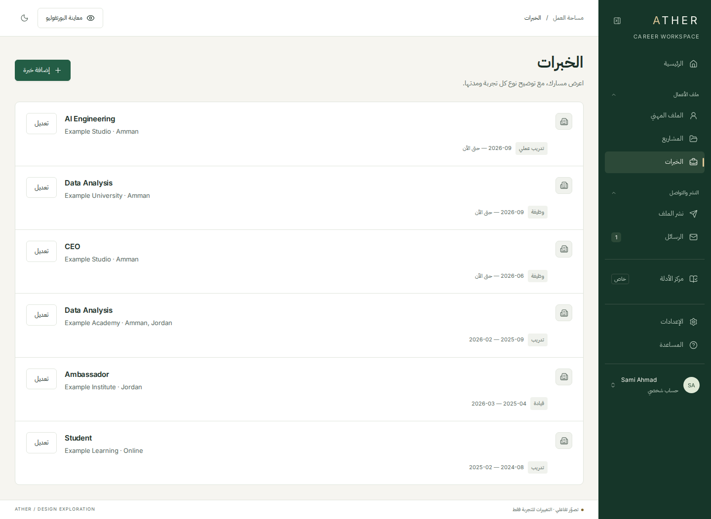 | 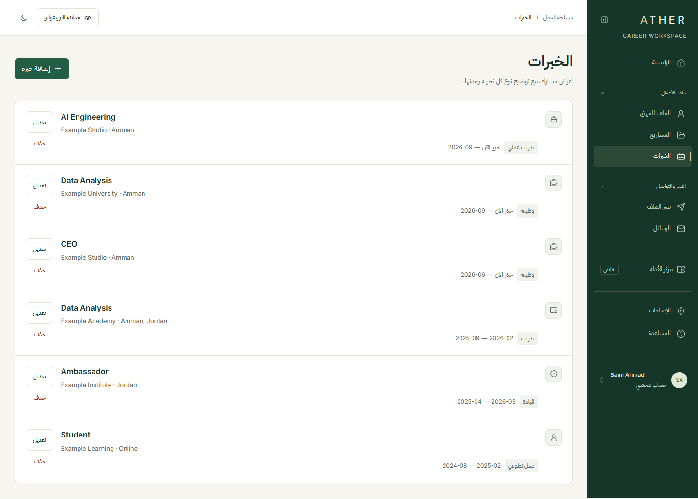 |
| list · 1440 ar dark | 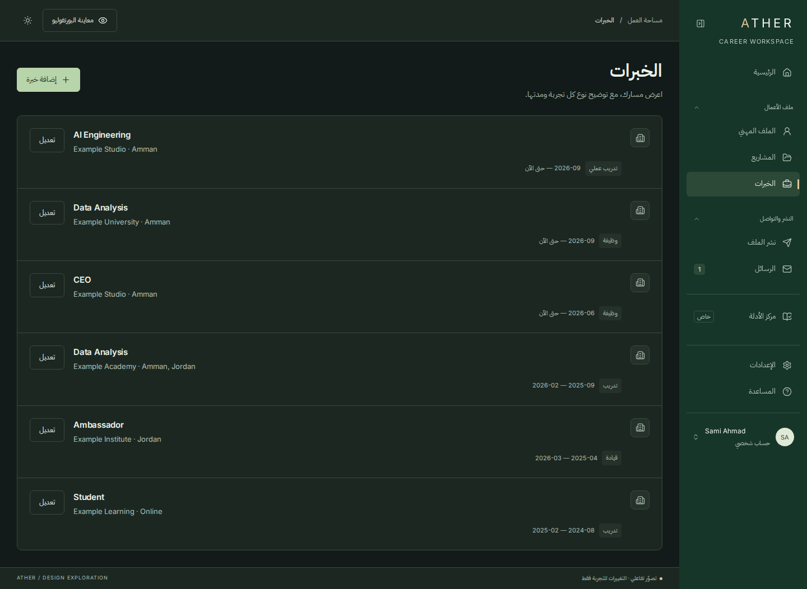 | 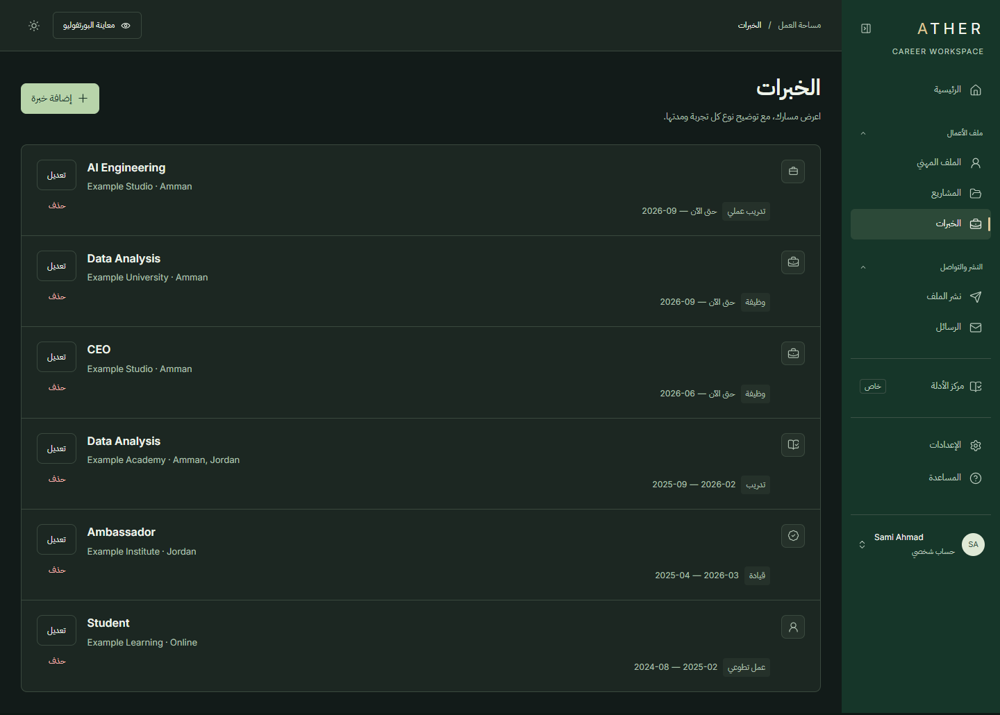 |
| list · 1440 en light |  | 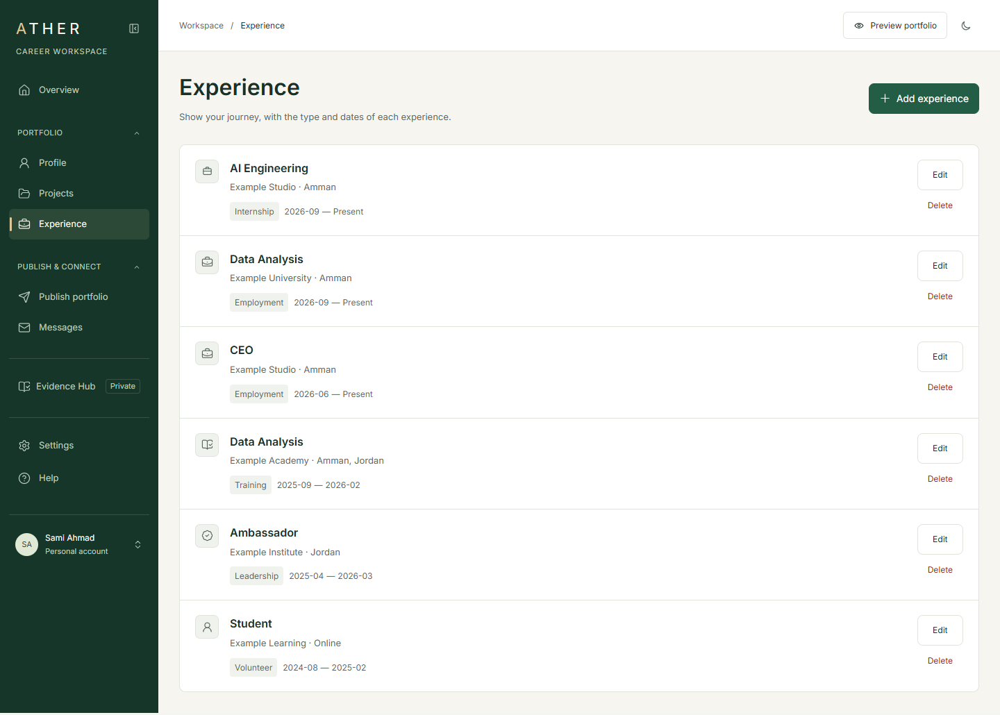 |
| list · 390 ar light |  | 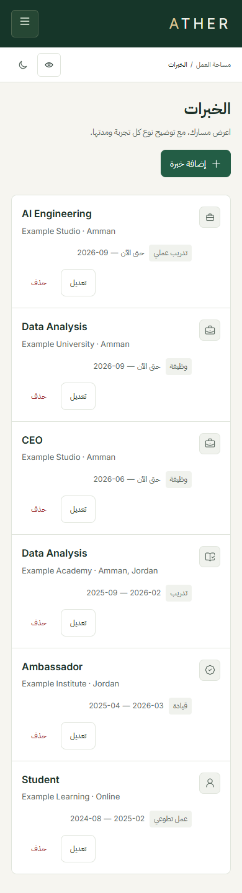 |
| list · 390 ar dark |  | 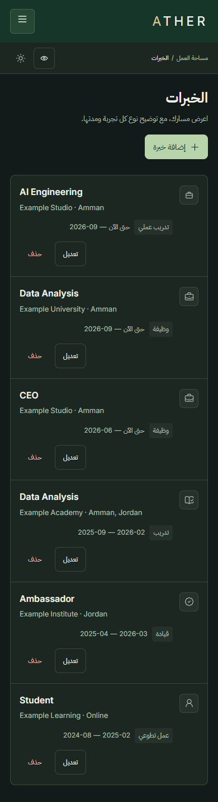 |
| list · 390 ar without JavaScript |  | 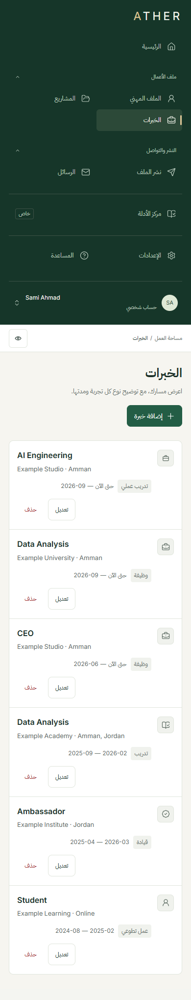 |
| edit · 1440 ar light | 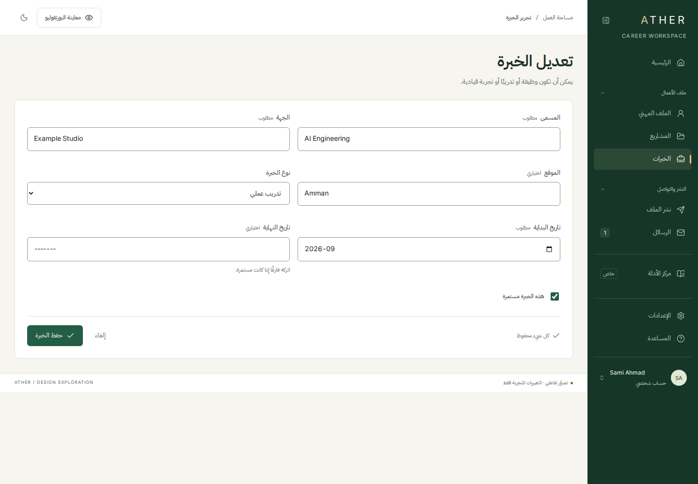 | 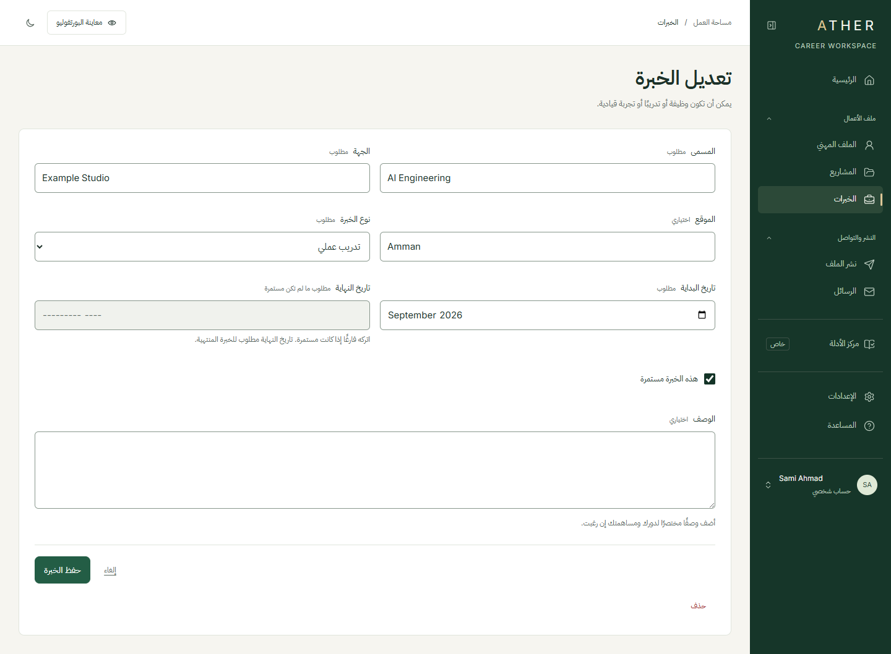 |
| edit · 1440 ar dark | 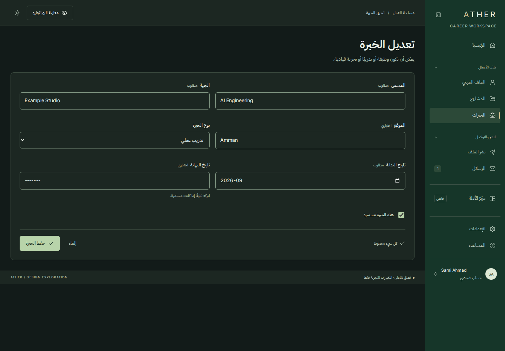 | 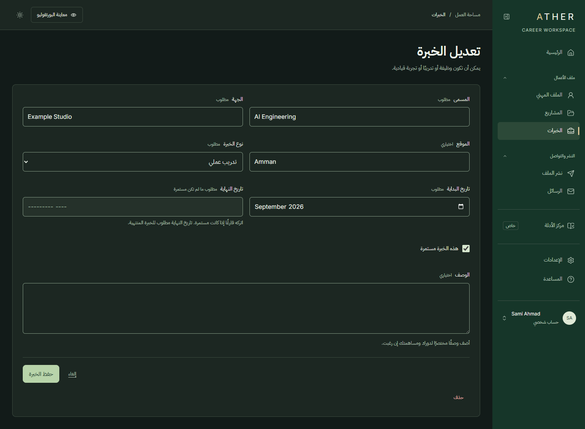 |
| edit · 1440 en light |  | 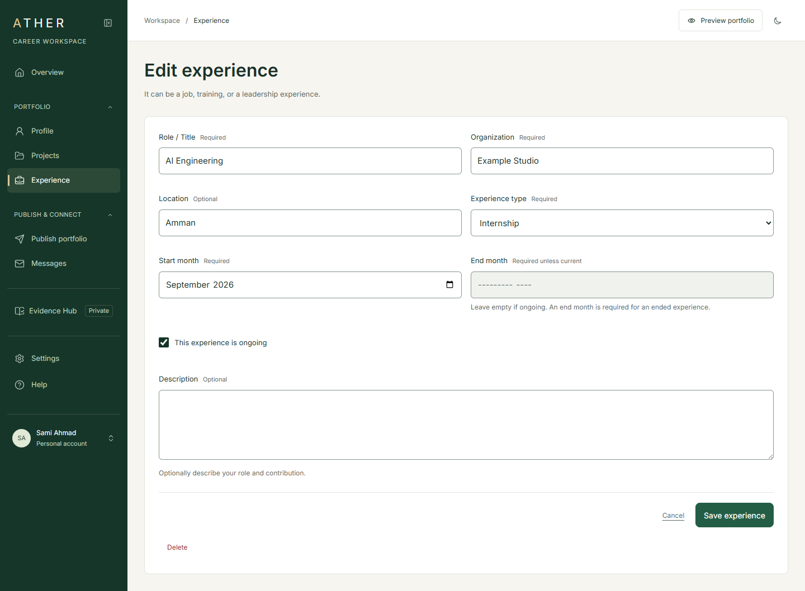 |
| edit · 390 ar light |  | 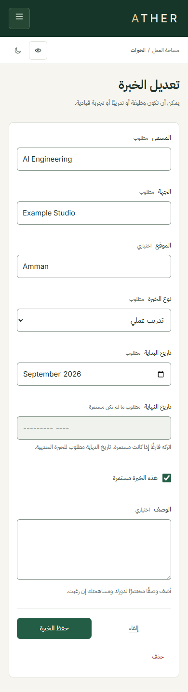 |
| edit · 390 ar dark |  | 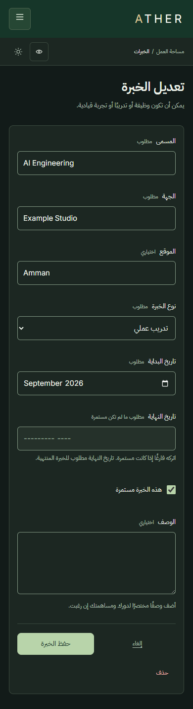 |
| edit · 390 ar without JavaScript |  | 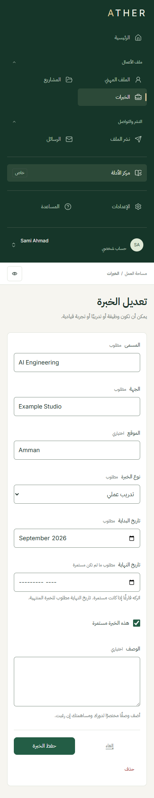 |
| Validation · 1440 ar light |  | 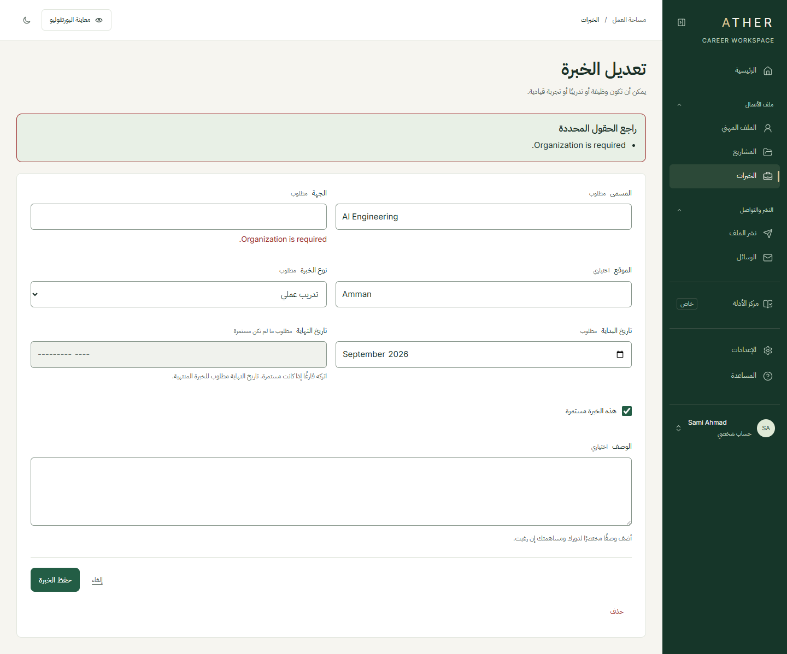 |
